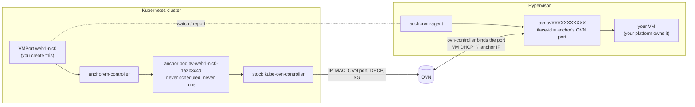
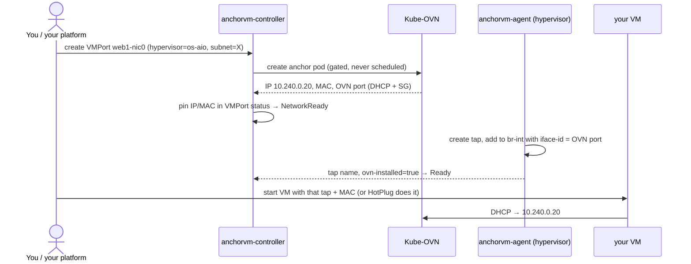
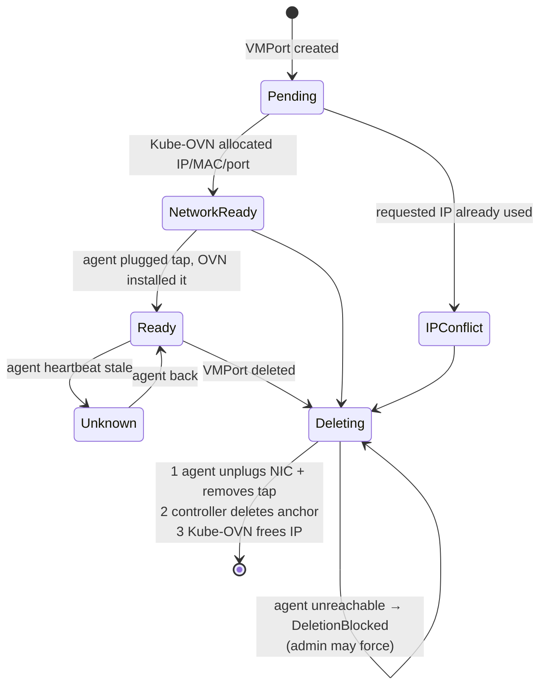

# anchorvm — put libvirt VM network cards on a Kube-OVN subnet

**What it does, in one sentence:** you create a `VMPort` in Kubernetes, and your
libvirt VM gets a network card on a Kube-OVN subnet — same subnet as your pods,
IP from Kube-OVN, no duplicates, cleaned up correctly when you delete it.

**What it does *not* do:** it never creates, starts, stops or deletes VMs, and
never touches disks or storage. Your platform keeps owning the VM. anchorvm owns
only the VM's network card (IP, MAC, OVN port, DHCP, security groups, tap device).

Works with **stock, unmodified Kube-OVN v1.16.0**. No KubeVirt.

---

## The one idea

Kube-OVN manages *pods* very well, but knows nothing about VMs outside Kubernetes.
So for every VM network card, anchorvm creates a **stand-in pod — the "anchor"
pod — that never runs**. Kube-OVN treats it like any pod:

- gives it an IP + MAC (Kube-OVN's own allocator → duplicates are impossible)
- creates its OVN port with DHCP and security groups
- keeps that port safe from Kube-OVN's garbage collection
- frees the IP when the anchor pod is deleted

Then the real VM on the hypervisor **plugs a tap into that OVN port**. The VM asks
DHCP and gets the anchor's IP. The VM is effectively *wearing* the pod's network identity.



## The three pieces

| Piece | Runs where | Job |
|---|---|---|
| **`VMPort`** (custom resource) | Kubernetes | What you ask for: "a NIC on subnet X for a VM on hypervisor Y" (optionally fixed IP, MAC, security groups). |
| **anchorvm-controller** | in the cluster (Deployment, leader election) | Creates the anchor pod, waits for Kube-OVN to allocate, writes IP/MAC/port name into the VMPort status, deletes things in the safe order. |
| **anchorvm-agent** | each hypervisor (systemd service) | For VMPorts of *its* host only: creates the tap, plugs it into OVN, optionally hot-plugs it into your VM, reports back. |

## The flow, step by step



## Lifecycle of a VMPort



- **Your VM stops / starts / reboots / is deleted by your platform** → nothing changes
  for the VMPort. The tap is persistent and the IP stays reserved until **you delete
  the VMPort**.
- **Deleting is strictly ordered**: the IP is freed only *after* the NIC is unplugged.
  So an IP can never be handed to someone else while a VM may still use it.

## Using it

### Mode 1 — TapOnly (default): your VM XML references the tap

```yaml
apiVersion: anchorvm.io/v1alpha1
kind: VMPort
metadata: {name: web1-nic0, namespace: team-a}
spec:
  hypervisor: os-aio
  network:
    nad: shadow-lab/shadow-net      # Kube-OVN NetworkAttachmentDefinition
    subnet: shadow-subnet
    # ip: 10.240.0.20               # optional fixed IP
    # securityGroups: [web]         # optional, can be changed later
```

```console
$ kubectl get vmport -n team-a
NAME        HYPERVISOR   PHASE   IP            MAC                 TAP
web1-nic0   os-aio       Ready   10.240.0.20   3a:aa:a7:21:c0:96   av4f1c2d9e0ab
```

Put exactly this in your VM's libvirt XML (MAC and tap from the status):

```xml
<interface type="ethernet">
  <mac address="3a:aa:a7:21:c0:96"/>
  <target dev="av4f1c2d9e0ab" managed="no"/>
  <model type="virtio"/>
  <mtu size="1400"/>
</interface>
```

### Mode 2 — HotPlug: anchorvm plugs the NIC into your existing VM

```yaml
spec:
  hypervisor: os-aio
  network: {nad: shadow-lab/shadow-net, subnet: shadow-subnet}
  attach: {mode: HotPlug, domain: web1}   # existing libvirt domain name
```

The agent attaches **only that one NIC** (live and persistent), and on delete detaches
**only that NIC**. Nothing else of the domain is touched.

### Day-2 operations

| Want to… | Do |
|---|---|
| change security groups | edit `spec.network.securityGroups` (live) |
| change per-port DHCP options | edit `spec.network.dhcpV4Options`, e.g. `mtu=1300` |
| delete a NIC | `kubectl delete vmport …` |
| delete while the hypervisor is dead | `kubectl annotate vmport … anchorvm.io/force-delete=true` (the agent removes the leftover tap when it comes back) |
| OVN lost the port (NB restore) | `kubectl annotate vmport … anchorvm.io/repair-network=true` (re-created with the same IP/MAC) |

Not changeable after creation (rejected by the API): `hypervisor`, `nad`, `subnet`,
`ip`, `mac`, `attach`.

## Safety rules (why many people can share it)

1. **Anchor pods can't be broken by accident.** An admission policy denies deleting,
   evicting, un-gating or editing anchor pods by anyone except the anchorvm
   controller (and Kube-OVN writing its own annotations). *Why so strict?* Kube-OVN
   frees a pod's IP the moment the pod is marked for deletion — a finalizer cannot stop
   it — so prevention is the only safe option.
2. **Unique names per instance.** Anchor = `av-<vmport>-<uid8>`, tap = `av` + hash of
   the VMPort UID. A VMPort deleted and recreated with the same name gets a *new*
   port, so a leftover tap on a dead host can never hijack it.
3. **No duplicate IPs.** Two VMPorts asking for the same IP: the oldest wins, the other
   shows `IPConflict`. A VMPort asking for a pod's IP (or the reverse): Kube-OVN refuses
   (`AddressConflict`). An IP is never reassigned automatically.
4. **Agents are fenced like kubelets.** Each hypervisor has its own identity. RBAC lets
   it only read VMPorts and write their status; an admission policy lets agent `os-aio`
   write **only** `status.agent` of VMPorts whose `spec.hypervisor` is `os-aio`.
5. **The agent's cleanup is careful.** It removes only taps/OVS ports it tagged itself,
   only when the API (not a cache) says the VMPort is gone on two passes a minute
   apart, and **never** touches domains or disks.
6. **A stuck delete never resolves itself.** It shows `DeletionBlocked` and waits for a
   human, because guessing could free an IP that is still in use.
7. **Kube-OVN upgrade guard.** anchorvm relies on Kube-OVN behaviour that is not a
   documented API. The controller refuses new VMPorts on an untested Kube-OVN version
   (`--allow-untested-kubeovn` after re-running `test/e2e.sh`).

## Security

| Layer | What | Protects against |
|---|---|---|
| Network | firewall: API port 6443 open only to the hypervisor's IP | anyone else reaching the API |
| TLS | agent verifies the cluster CA; traffic encrypted | sniffing, fake API server |
| Identity | one ServiceAccount per hypervisor | sharing credentials |
| RBAC | agent: read VMPorts, patch their status, renew its own Lease — nothing else | a compromised agent touching pods, secrets, … |
| Admission policy | agent may write only `status.agent`, only for its own host | a compromised hypervisor affecting other hosts' ports |

## Failure behaviour

| What fails | What happens |
|---|---|
| your VM crashes / is deleted | VMPort stays Ready, IP stays reserved |
| hypervisor reboots | agent recreates the taps on start; OVN re-binds |
| agent down | VMPorts show `Unknown`; data path keeps working; deletes wait (`DeletionBlocked`) |
| controller down | nothing changes; new VMPorts wait |
| kube-ovn-controller restart | IPs kept (Kube-OVN restores from anchors); hypervisor chassis briefly re-registers (<1 s blip, see "yet to implement") |
| OVN NB restart | ports kept (observed live) |
| someone deletes an anchor pod | denied by policy; if an admin bypasses it, the controller recreates it with the same IP/MAC |
| two VMPorts want one IP | older wins, newer `IPConflict` |
| untested Kube-OVN version | new VMPorts refused until re-verified |

## Install

```bash
kubectl apply -f config/crd/ -f config/rbac/role.yaml -f config/deploy/controller.yaml -f config/vap/
# per hypervisor (cluster-admin):
hack/add-hypervisor.sh os-aio https://<api-server>:6443 > kubeconfig-os-aio
# on the hypervisor (needs OVS br-int + ovn-controller registered in the cluster's OVN):
install -m 0755 anchorvm-agent /usr/local/bin/
install -m 0600 kubeconfig-os-aio /etc/anchorvm/kubeconfig
printf 'ANCHORVM_HYPERVISOR=os-aio\nANCHORVM_MTU=1400\n' > /etc/anchorvm/agent.env
cp config/hypervisor/anchorvm-agent.service /etc/systemd/system/ && systemctl enable --now anchorvm-agent
```

Build: `CGO_ENABLED=0 go build -o bin/ ./cmd/...`, image: `docker build -t anchorvm-controller:<v> .`

## Test results (2026-10-22)

`test/e2e.sh` on train + os-aio: **48 passed, 0 failed** (`test/e2e-run2.log`), covering TapOnly and
HotPlug attach, DHCP and ping, platform VM restart/delete, duplicate IPs (port↔port, port↔pod),
live security-group changes, anchor protection (delete, un-gate, edit, eviction), agent identity
limits, ordered delete and IP reuse, delete with the agent down plus force-delete, same-name
recreation, agent and controller restarts, repair after an OVN port loss, and namespace deletion.
Unit tests: `go test ./...`. Over the same afternoon, anchor-pod VMs lost 0 pings through two
kube-ovn-controller restarts, one ovn-central restart and a 30 s GC interval.

## MVP status

**Done in this MVP:** everything above — VMPort API with immutability rules, controller
(anchor create/adopt/pin/recreate, IP-conflict index, ordered finalizer, force-delete,
repair, SG/DHCP sync, Kube-OVN version gate, agent heartbeat), agent (tap/OVS port,
HotPlug attach/detach, reboot recovery, careful stale-port cleanup, Lease), three
admission policies, per-hypervisor identity, unit tests, live e2e suite.

**Yet to implement** (marked so nobody assumes them):

- [ ] **Chassis GC blip** — every kube-ovn-controller restart deletes the hypervisor's
      OVN chassis (<1 s, re-registers). Planned fix: opt-in "virtual Node" per hypervisor
      (stock Kube-OVN keeps chassis of Nodes). Needs live testing first.
- [ ] Live migration of a VM between hypervisors.
- [ ] Token / credential rotation for agents (today: long-lived ServiceAccount token).
- [ ] Prometheus metrics beyond controller-runtime defaults; alerts.
- [ ] Firewall rule is hand-added to `hai-fw.nft`; it does not survive a re-render of
      the host-firewall role and must be added to that role.
- [ ] Startup canary self-test of Kube-OVN behaviour (today: version allowlist only).
- [ ] Scale test (hundreds of VMPorts).
- [ ] Multi-NIC convenience (today: one VMPort per NIC).
# kubeovn-vm
